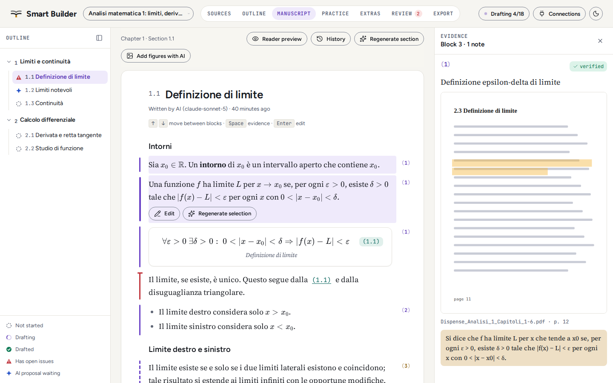
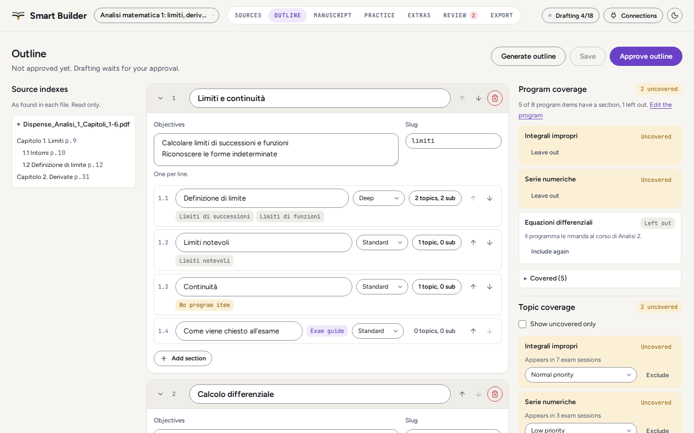
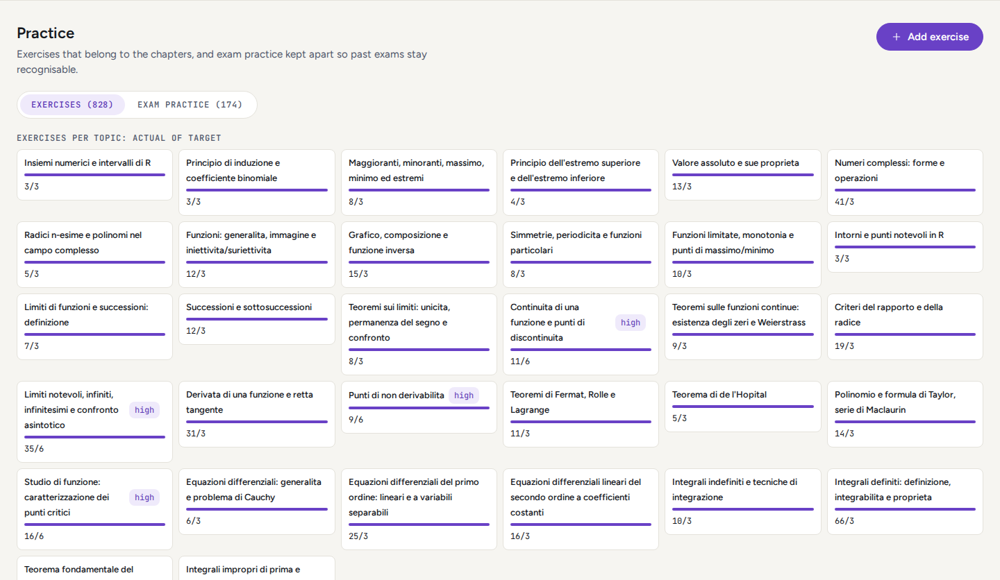

<p align="center">
  
</p>

<h1 align="center">Smart Builder</h1>

<p align="center">
  A local app that turns your course material into an interactive textbook.<br>
  Add lecture notes, textbooks and past exams. It drafts a cited book with formulas and exercises, and you edit it before export.
</p>

<p align="center">
  <a href="https://github.com/SuperTost100/politost-smartbook-builder/releases/latest"></a>
  <a href="https://github.com/SuperTost100/politost-smartbook-builder/actions/workflows/ci.yml"></a>
  <a href="LICENSE"></a>
</p>

<p align="center">
  <a href="#start">Start</a> ·
  <a href="docs/SETUP.md">Documentation</a>
</p>

<picture>
  <source media="(prefers-color-scheme: dark)" srcset="docs/screenshots/manuscript-dark.png">
  
</picture>

## Why Smart Builder

A model asked to write a textbook chapter writes something fluent, and you can't tell which parts came from your course. Smart Builder works the other way round. It finds the passages in your sources first, writes from them, and shows you the original page behind every citation. A quote it can't find on its page is dropped.

It also reads your past exams. It counts how many exam sessions test each topic, so the book spends its depth and its exercises where the exams do. If you paste the course program, the outline follows it, and an existing book can be checked against it.

It runs on your computer. The AI work goes through the command-line tools you already pay for (Claude Code, Codex, Cursor Agent, Antigravity) by way of [cli-funnel](https://github.com/SuperTost100/cli-funnel), plus NotebookLM if you use it. There is no API key to set up and no account to create. The finished book is a `.ptsb` file that the [Smartbook reader](https://github.com/SuperTost100/politost-smartbook) and [Pyxis](https://github.com/SuperTost100/politost-pyxis) open.

## What it does

1. **Reads your sources.** PDF (text or scanned), Word, PowerPoint, Markdown and web pages. Pages whose math the PDF text layer garbles go to a vision model.
2. **Maps the course.** It keeps each source's own index, splits past exams into sessions and questions (Split with AI handles a paper layout it doesn't know), and counts how often each topic appears.
3. **Proposes an outline** that you edit and approve. Topics the exams test often get deeper sections and more exercises.
4. **Writes each section from evidence.** NotebookLM, or a local search plus a reader model, returns verbatim passages. Each one is located on its page before the writer may cite it. The sections of a chapter are written in order, and the writer checks its own section once before it is stored.
5. **Adds figures where the student has to see something.** Each book has a subject area (mathematics, physics, chemistry, electronics, computer science, mechanics or other) that decides which kinds the writer may use. Function plots (with linear or logarithmic axes), molecule structures and chemistry diagrams are drawn from validated specs. Photos come from Wikimedia Commons, Pixabay or Pexels with their credit. Anything else, such as a circuit, a logic network, a timing diagram or a free-body sketch, is described by the writer, drawn as Typst or schemdraw code by a separate illustrator model, compiled on your computer and checked against its own picture.
6. **Checks its own output.** Lint catches broken formulas, leftover model commentary and Unicode math. A second model solves every exercise again and a Python computation recomputes numeric answers, Python examples run in Pyodide and MATLAB examples in numbl, and graphs are evaluated over their domain. A reviewer reads each chapter, a second model confirms every finding before you see it, and a fix is applied only after guards check it.
7. **Lets you finish the book.** Edit any block with a live formula preview, regenerate a passage with an instruction, accept or reject AI proposals, change a figure (edit the source of a drawing, redraw it with an instruction, replace it with your own image) or add one, and export a validated `.ptsb`.

Your edits are never overwritten. AI output that arrives after you changed a section becomes a proposal you accept or reject.

<table>
  <tr>
    <td width="50%">
      <picture>
        <source media="(prefers-color-scheme: dark)" srcset="docs/screenshots/outline-dark.png">
        
      </picture>
    </td>
    <td width="50%">
      <picture>
        <source media="(prefers-color-scheme: dark)" srcset="docs/screenshots/practice-dark.png">
        
      </picture>
    </td>
  </tr>
  <tr>
    <td>The outline shows which program item each section covers and how many exam sessions test each topic.</td>
    <td>Exercises per topic, with the high-priority topics marked.</td>
  </tr>
</table>

## Start

You need:

- Node.js 22.13 or newer. 24 is recommended and pinned in `.nvmrc`.
- At least one signed-in AI command-line tool: [Claude Code](https://docs.claude.com/en/docs/claude-code), [Codex](https://github.com/openai/codex), Cursor Agent or Antigravity.
- Optional: [`nlm`](https://github.com/jacob-bd/gemini-notebook-mcp-cli) for NotebookLM evidence, and LibreOffice for Word and PowerPoint files.

```bash
git clone https://github.com/SuperTost100/politost-smartbook-builder.git
cd politost-smartbook-builder
npm ci
npm run doctor     # what is installed and signed in, and how to fix the rest
npm start          # builds the web app and serves it on http://localhost:5300
```

The first `npm start` needs a network connection, because it also downloads the pinned packages that drawn figures need into `.figure-packages/` in the repository (about 7 MB, each file checked against a SHA-256 hash). After that, figures render offline. `npm run doctor` fetches them too, and `npm run figure-packages` does it by hand. If the download fails, the app still starts and says drawings are unavailable until it succeeds.

To use it from another device on your network, such as a laptop reaching a desktop over Tailscale:

```bash
npm start -- --lan
```

The command prints a link with an access token. Open it once on each device. Without the token, the service refuses every request.

Closing the browser does not stop generation. Stopping the service pauses it, and the next start resumes where it left off.

## Your data

Everything lives in one folder: the database, your original files, rendered pages, figures and exports. On Linux that's `~/.local/share/politost-smart-builder`. [Setup](docs/SETUP.md#data) lists the other systems, and `--data-dir` or `SMARTBUILDER_DATA_DIR` moves it. `npm run backup` writes the whole folder to one archive, and it's safe to run while the service is running.

Your sources go to the AI tools you configured and, if you use it, to the book's NotebookLM notebook. Exclude a source on the Sources screen to keep it out. The models run with every tool disabled, except that the web research of **Find outside sources** lets Claude Code use WebSearch and WebFetch. So they only read the text Smart Builder sends (and, for that one call, pages on the web) and can't run commands or touch your files. For Codex, and for Claude Code's web research, the service creates a private config folder inside the data folder that holds only a link to your login, so your own instructions and skills aren't sent with every call.

## Configuration

Flags go after `npm start --`. The service listens on `127.0.0.1` unless you pass `--lan`.

| Setting                                          | Default                                 | What it does                                     |
| ------------------------------------------------ | --------------------------------------- | ------------------------------------------------ |
| `--port <n>` or `PORT`                           | `5300`                                  | Port the service listens on                      |
| `--host <address>`                               | `127.0.0.1`, or `0.0.0.0` with `--lan`  | Address the service binds to                     |
| `--lan`                                          | off                                     | Lets other devices connect, with an access token |
| `--data-dir <folder>` or `SMARTBUILDER_DATA_DIR` | Per system, see [Your data](#your-data) | Where the database and files live                |

## Development

```bash
npm run dev          # service in watch mode, web app on Vite at http://localhost:5173
npm run typecheck
npm test
npx playwright install chromium            # once, for the end-to-end tests
npm run build -w @smartbuilder/web         # the end-to-end tests serve the built app
npm run test:e2e     # Playwright tests for the web app, with no model calls
```

The drawing tests download the figure packages themselves when they are missing. CI runs `typecheck`, `test`, the web build and the end-to-end tests on every push and pull request.

## Documentation

| Read this                                | To learn                                                     |
| ---------------------------------------- | ------------------------------------------------------------ |
| [Setup and model routing](docs/SETUP.md) | Signing in each tool, which model does which job, NotebookLM |
| [How a book is made](docs/WORKFLOW.md)   | Every step from sources to export, and what each one checks  |
| [Architecture](docs/ARCHITECTURE.md)     | How the service, the queue and the web app fit together      |
| [Status](STATUS.md)                      | What works today and what is still open                      |

## Sources and copyright

Smart Builder doesn't check who owns the material you import. You need the right to use your sources, and to share the books you make from them if you share those books. Photos from Pixabay and Wikimedia Commons carry their credit in the caption. Keep it when you publish. The AI tools you connect have their own terms, and those terms apply when Smart Builder uses them for you.

Smart Builder comes as is, with no warranty and no liability for what you make with it. Sections 15 and 16 of the [license](LICENSE) give the full wording.

## License

AGPL-3.0-or-later. Smart Builder uses [MuPDF](https://mupdf.com/) (AGPL) for PDF reading and code adapted from the [Smartbook reader](https://github.com/SuperTost100/politost-smartbook) (AGPL). Books you make with it are yours and aren't covered by this license.

Drawn figures use these third-party components, all compatible with the AGPL: the [Typst](https://github.com/typst/typst) compiler through [typst.ts](https://github.com/Myriad-Dreamin/typst.ts) (Apache-2.0), the Typst packages [CeTZ](https://github.com/cetz-package/cetz) and [cetz-plot](https://github.com/cetz-package/cetz-plot) (LGPL-3.0-or-later), [zap](https://codeberg.org/grangelouis/zap), [fletcher](https://github.com/Jollywatt/typst-fletcher), [lilaq](https://github.com/lilaq-project/lilaq), [finite](https://github.com/jneug/typst-finite) and their helper packages (MIT, MIT-0 or Apache-2.0), [schemdraw](https://github.com/cdelker/schemdraw), ziamath, ziafont and latex2mathml (MIT, the first two bundle the STIX Two Math and DejaVu Sans fonts) and [resvg](https://github.com/linebender/resvg) through `@resvg/resvg-js` (MPL-2.0). The Typst packages and Python wheels are downloaded unchanged by `scripts/fetch-figure-packages.mjs`, which lists every version and hash, and each carries its own license file.
